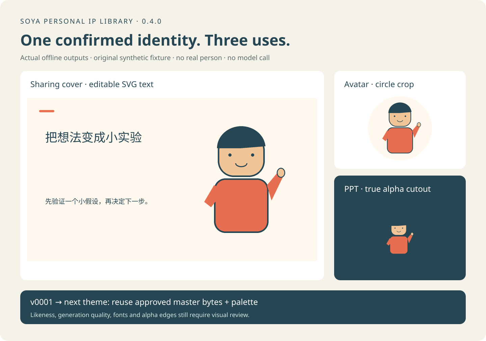

# Soya Portrait Illustrator · 个人 IP 素材库

[](CHANGELOG.md)
[](LICENSE)

**一个 Skill，一句启动指令。** 上传一张有权使用的普通照片，说：

> 按这张照片建立我的个人IP素材库。

Skill 会检查环境，补问用途、分享主题和观点，确认人物母版，再交付**头像、可编辑文字的分享封面、PPT 透明插画**。保存已确认的形象版本和配色，下次换主题继续用。普通、不精修的照片也可以作为参考，重点保留可见外貌、穿衣风格和配饰；模糊、遮挡和镜面反射会影响可识别信息，不保证生成相似度。

[English](README.en.md) · [Skill 工作流](SKILL.md) · [参赛材料清单](references/competition-checklist.md)



## 先确认运行条件

本项目是 Agent Skill 与离线导出脚本，**不包含生图模型、额度、API Key 或去背服务**。简单启动不等于所有环境都能零配置运行。

| 部分 | 需要的宿主能力 |
|---|---|
| 从照片建立人物母版 | 能看上传照片、按参考图编辑图片、保存可访问文件的 Agent；输出透明插画需真 alpha 通道 |
| 保存版本、导出与检查 | Python 3.9+（推荐 3.10+）、Pillow 10–11；本次测试使用 Python 3.9.6 / Pillow 11.3.0 |
| 查看预览与改封面字 | 本地浏览器、中文系统字体；SVG 编辑器可修改文字元素 |

脚本使用 Python 3.9 可执行的语法与标准库；推荐 Python 3.10+。宿主缺少参考图编辑时，Skill 会说明缺口并整理需求，不能把导出脚本当成生图器。新收费调用或向外部服务上传照片前，需要明确数据、服务与费用。项目脚本本身无联网调用。

## 安装和启动

下载可安装 ZIP，解压后将整个 `soya-portrait-illustrator` 文件夹放入宿主的 Skills 目录，确保目录下直接看到 `SKILL.md`。Codex 常用位置：

```text
~/.codex/skills/soya-portrait-illustrator/SKILL.md
```

重新加载 Skills 后上传照片，说上面的启动句即可；也可明确调用：

```text
用 $soya-portrait-illustrator 按这张照片建立我的个人IP素材库。
```

Agent 负责调用脚本。以下 CLI 供开发者复现，不是用户每次启动必须复制的长提示词。

若只想验证本地导出而不连接生图服务：

```bash
python3 -m venv ../soya-ip-venv
source ../soya-ip-venv/bin/activate
python3 -m pip install -r requirements.txt
python3 scripts/create_synthetic_demo.py --out ../synthetic-demo
```

打开 `../synthetic-demo/first-share/preview.html`。程序用 Pillow 绘制原创几何角色，完成首次交付和换主题复用；无真人、无照片上传、无模型调用。示例只验证导出链路。

## 一次分享会交付什么

| 产物 | 用途及检查 |
|---|---|
| `avatar.png`，1024×1024 | 在 48/96/192 像素圆形裁切中看辨识度、头发和配饰是否被裁 |
| `cover.svg`，1920×1080 | 人物与文字分层；标题与观点是可编辑 SVG 文字，减少生成文字乱码 |
| `cover-background.png` | 不带标题和观点的封面底图，便于重新排版 |
| `ppt-cutout.png`，1600×1600 | 真 RGBA 透明插画，可插入 PPT；浅底、深底和棋盘格检查边缘 |
| `preview.html` / `brief.json` / `kit-manifest.json` | 离线预览、可修改文案、形象版本、配色、尺寸、哈希及检查结果 |

当前封面只有一种左右分区布局，文字超出容量会报错；中文字体仍需在实际设备检查。SVG 的文字元素可编辑，导入 PowerPoint 可能被扁平化；本版不生成原生 PPT 文本框或 PPTX。脚本不做 OCR、不判断真人相似度，也不能保证生成母版内没有残留文字。

## 保存形象，下次继续用

用户确认两张母版后，Agent 在源码目录外保存库；不自动收录原始照片：

```bash
python3 scripts/ip_library.py record \
  --library ../my-ip-library --identity-id my-character --style anime \
  --square ../work/square.png --cutout ../work/cutout.png --confirmed
python3 scripts/ip_library.py build \
  --library ../my-ip-library --version v0001 \
  --brief templates/share-brief.json --out ../deliveries/first-share
```

`--confirmed` 必须来自真实确认，不能替代确认。版本记录母版哈希、配色与父版本；旧版本不覆盖。下次说「沿用上次的人物，准备一个新主题的分享」即可由 Agent 选定版本、更新文案并导出。

文字改动只改 brief；配色改动建立子版本；人物修改只替换已重新确认的相应母版，未改动的母版按字节保留。生成模型的区域编辑仍可能改变其他细节，需要人工检查。命令、manifest 协议和失败处理见 [本地素材库说明](references/personal-library.md)。

## 从 v0.3.0 升级了什么

新增本地个人 IP 库、确认版本与配色、跨主题复用、窄范围修订、三用途分享交付、文字层、实际预览和失败报告。**四人物母版、17 个尺寸、两种画风、母版确认和质量规则均为已有能力。**

旧的完整多尺寸包继续使用 `scripts/export_asset_pack.py`，见 [17 个预设与命令](references/asset-pack-presets.md)。本次没有承诺更强的生成模型或真人一致性。

## 验证与打包

```bash
python3 scripts/validate_skill.py .
python3 -m unittest discover -s tests -v
python3 scripts/release_audit.py --history
python3 scripts/package_skill.py --out ../soya-portrait-illustrator-0.4.0.zip
```

ZIP 为单层 Skill 文件夹，带许可证和运行脚本；文件白名单防止误带私人库、原始照片、密钥、环境或 `.git`。重复构建相同源码的 ZIP 哈希相同。历史扫描是启发式检查，不能代替人工审阅和授权核实。附带 [GitHub Actions 模板](references/github-actions.yml)。当前 GitHub 登录缺少 `workflow` 权限，因此未自动启用 CI；有该权限后，可将模板复制为 `.github/workflows/validate.yml`。本地验证和打包已可运行。

## 作者自用案例与参赛状态

SOYA 是第一个真实用户。已预留[作者自用案例与材料缺口](references/competition-checklist.md)，等待她确认具体照片、真实反馈和可公开范围。本版没有新增外部用户反馈、节省时间或模型效果数据。

当前已具备代码、Skill、合成样例和安装包；真实生图验收、完整操作录像及具体比赛要求仍待补齐。未报名或提交比赛。历史视觉记录与本版实测分开列于[验证记录](references/validation-notes.md)。

## 隐私、依赖与限制

私人库和交付物始终保存在源码目录外。新母版转存会清除 EXIF 和 PNG 文本信息，但肖像本身仍是个人数据。不要把真实照片、生成真人像、私人主题或外部服务日志提交 GitHub。公开授权与处理授权分开确认。详见 [PRIVACY.md](PRIVACY.md)。

唯一第三方 Python 依赖是 [Pillow](https://github.com/python-pillow/Pillow)，来源为官方 PyPI `Pillow` 包，采用 [MIT-CMU 许可证](https://github.com/python-pillow/Pillow/blob/11.3.0/LICENSE)。不捆绑字体、模型权重或第三方人物素材；合成几何样例由本项目脚本自制，随项目采用 MIT。原有图标与代码沿用仓库 MIT 许可。[MIT](LICENSE) © 2026 Soya。
